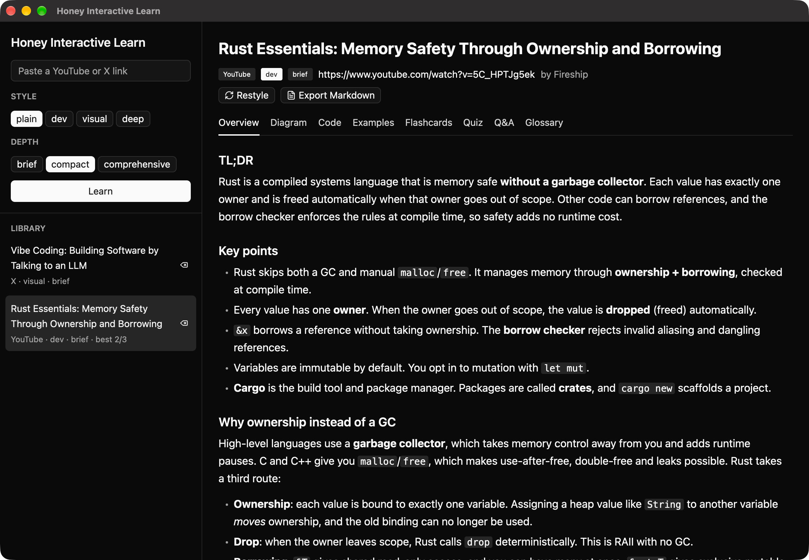
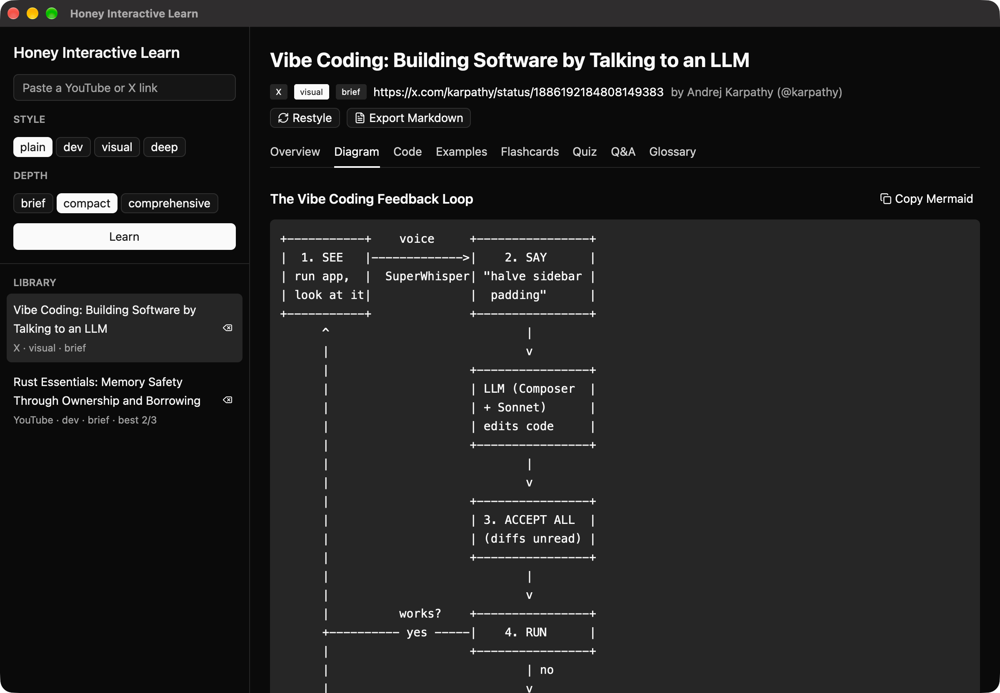
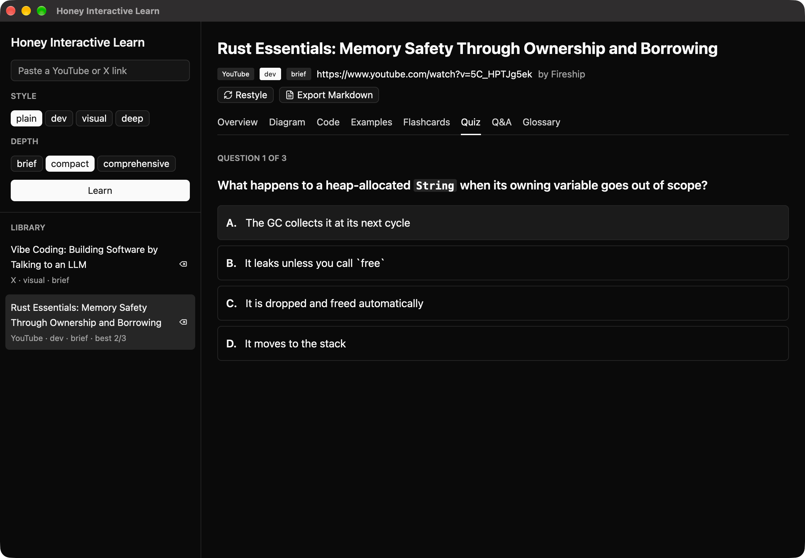
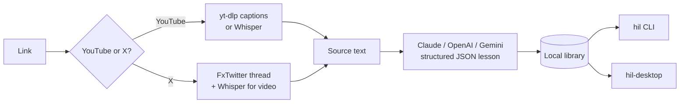

# 🍯 Honey Interactive Learn

**Paste a YouTube or X link. Get a lesson you'll remember.**

`hil` (CLI) and `hil-desktop` (GPUI app) turn a video or a post into a compact lesson. Each lesson has a TL;DR, key points, a diagram, code snippets, real-world examples, flashcards, a multiple-choice quiz and open questions. Pick the voice that fits how you learn: **plain**, **dev**, **visual** or **deep**. Pick the size: **brief**, **compact** or **comprehensive**.

[](https://github.com/umararshad4/honey-interactive-learn/actions/workflows/ci.yml)
[](https://github.com/umararshad4/honey-interactive-learn/releases)
[](LICENSE)

```text
$ hil learn https://www.youtube.com/watch?v=5C_HPTJg5ek --style dev --depth brief
✓ Rust in 100 Seconds · Fireship · 3788 chars of auto-captions

Rust Essentials: Memory Safety Through Ownership and Borrowing
YouTube · Fireship · 02:29 · dev / brief

TL;DR
Rust is a compiled systems language that is memory safe without a garbage collector…

Diagram: Ownership, move, borrow, drop
    let s = String::from("hi");      let t = s;  (move)
    +-------+      +---------+      +-------+
    | s     |----->| heap:hi |  ==> | t     |---> heap:hi
    +-------+      +---------+      +-------+
…
Take the quiz now? [Y/n]
```

## Features

- **YouTube.** Uses captions (manual first, then auto captions), plus the video description and chapters. Videos without captions fall back to local [Whisper](https://github.com/openai/whisper) transcription.
- **X / Twitter.** Reads posts, the author's whole thread, quoted posts and long-form articles, with no login needed (via the [FxTwitter](https://github.com/FixTweet/FxTwitter) API). Video posts are transcribed with Whisper.
- **Four learning styles:**

  | Style | What you get |
  |---|---|
  | `plain` | Everyday language, analogies, jargon defined on first use |
  | `dev` | Precise terms, runnable code snippets, commands, trade-offs and pitfalls |
  | `visual` | A detailed diagram as the centrepiece, tables, flows and hierarchies |
  | `deep` | First principles, edge cases, misconceptions and limits of the claims |

- **Three depths:** `brief` (about 3 quiz questions), `compact` (5) and `comprehensive` (10, with more sections and cards).
- **Practice built in.** An interactive MCQ quiz with explanations, score history and a "review these" list. Flip-style flashcards. Open questions with model answers.
- **Diagrams everywhere.** An ASCII diagram for the terminal and the app, and a Mermaid diagram in Markdown exports, which renders on GitHub, Obsidian and VS Code.
- **One library.** The CLI and the desktop app share the same saved lessons. `restyle` rewrites a saved lesson in another style without re-downloading the source.
- **Your model, your account.** Use **Anthropic (Claude)**, **OpenAI** or **Google Gemini** with your own API key, or your existing **Claude Code** login through the `claude` CLI with no key at all. Pick the provider in the app's Settings or with `hil config`.

## Install

### Requirements

| Tool | Why | Install |
|---|---|---|
| `yt-dlp` | YouTube captions and video audio | `brew install yt-dlp` |
| `ffmpeg` | Audio decoding for Whisper | `brew install ffmpeg` |
| `whisper` *(optional)* | Videos without captions, X videos | `pipx install openai-whisper` |
| One AI provider | Writing the lesson | An [Anthropic](https://console.anthropic.com/), [OpenAI](https://platform.openai.com/api-keys) or [Gemini](https://aistudio.google.com/apikey) API key, **or** [Claude Code](https://claude.com/claude-code) logged in |

Run `hil doctor` to check them all.

### Desktop app (macOS)

1. Download `Honey-Interactive-Learn-<version>-aarch64.zip` (Apple Silicon) or `-x86_64.zip` (Intel) from [Releases](https://github.com/umararshad4/honey-interactive-learn/releases).
2. Unzip it and drag **Honey Interactive Learn.app** to **Applications**.
3. The first time, right-click the app → **Open** (it is ad-hoc signed, not notarized). Or run `xattr -dr com.apple.quarantine "/Applications/Honey Interactive Learn.app"`.
4. Open **Settings** (gear icon), choose a provider and paste your API key.

Or build and install it from source: `packaging/macos/bundle.sh --install`.

When opened from the Dock or Finder, the app reads `PATH` and any `*_API_KEY` variables from your login shell. Tools installed with Homebrew and keys exported in `~/.zshrc` therefore work there too.

### CLI binaries

Download `hil` for macOS (Apple Silicon, Intel) or Linux x86_64 from [Releases](https://github.com/umararshad4/honey-interactive-learn/releases):

```sh
tar xzf hil-v0.2.0-aarch64-apple-darwin.tar.gz
mv hil-v0.2.0-aarch64-apple-darwin/hil /usr/local/bin/
```

### From source

Requires Rust 1.88+ for the CLI, and a recent stable Rust for the desktop app.

```sh
# CLI
cargo install --git https://github.com/umararshad4/honey-interactive-learn hil-cli

# Desktop app as a real macOS .app in /Applications
git clone https://github.com/umararshad4/honey-interactive-learn
cd honey-interactive-learn
packaging/macos/bundle.sh --install
```

## CLI usage

```sh
hil learn <url>                       # plain + compact by default
hil learn <url> -s dev -d comprehensive
hil learn <url> -s visual --quiz      # go straight into the quiz
hil list                              # your library, newest first
hil show 1                            # whole lesson (1 = newest, or an id prefix)
hil show 1 --only diagram --only code
hil show 1 --only quiz --answers
hil quiz 1                            # interactive MCQ quiz, saves your score
hil cards 1                           # flashcards
hil restyle 1 -s deep                 # same source, new style
hil export 1 -o lesson.md             # Markdown with Mermaid diagram
hil export 1 --json                   # raw lesson JSON
hil learn <url> -b openai             # pick the provider for one run
hil transcript <url>                  # just the extracted text
hil rm 1
hil doctor                            # tools, keys and which provider will be used
hil config                            # show settings (keys masked)
hil config set backend gemini         # auto | claude-cli | anthropic | openai | gemini
hil config set openai-key <key>       # anthropic-key | openai-key | gemini-key
hil config set openai-model gpt-6-luna
```

Supported links: `youtube.com/watch?v=…`, `youtu.be/…`, `/shorts/…`, `/live/…`, `x.com/<user>/status/<id>`, `twitter.com/…`, `fxtwitter.com/…`.

## Desktop app

`hil-desktop` is a native GPU-rendered app built with [GPUI](https://gpui.rs) (the framework behind the Zed editor) and [gpui-component](https://github.com/longbridge/gpui-kit).

- **Sidebar:** a link box, style and depth pickers, and your library with best quiz scores.
- **Lesson tabs:** Overview, Diagram, Code, Examples, Flashcards (click to flip), Quiz (click an answer to see green/red feedback and the explanation), Q&A and Glossary.
- **Restyle** a lesson in place, and **export Markdown**.
- **Settings:** choose the AI provider, paste API keys and override models. These settings are shared with the CLI.

| Overview | Diagram | Quiz |
|---|---|---|
|  |  |  |

Launch options: `hil-desktop --select <id-prefix> --tab quiz` opens a lesson straight to a tab.

## Configuration

Settings live in `settings.json` in the data directory below, and `hil config` or the app's Settings edit that file. The file is readable only by you. Environment variables override it.

### Providers

| Provider | Key | Default model | Notes |
|---|---|---|---|
| `anthropic` | `ANTHROPIC_API_KEY` / `anthropic-key` | `claude-opus-5-5` | Structured outputs, streaming, server-side refusal fallback |
| `openai` | `OPENAI_API_KEY` / `openai-key` | `gpt-6-astra` | Responses API with strict JSON schema |
| `gemini` | `GEMINI_API_KEY` (or `GOOGLE_API_KEY`) / `gemini-key` | `gemini-3.8-flash` | `generateContent` with JSON schema |
| `claude-cli` | none, uses your Claude Code login | your Claude Code default | Runs `claude -p` headless with tools disabled |

With `auto` (the default), the first available provider is used, in this order: Anthropic key, OpenAI key, Gemini key, then the `claude` CLI.

### Environment variables

| Variable | Default | Meaning |
|---|---|---|
| `HIL_BACKEND` | `auto` | `auto`, `claude-cli`, `anthropic`, `openai` or `gemini` |
| `HIL_MODEL` | see the table above | Model override for the chosen provider |
| `HIL_EFFORT` | provider default | Reasoning effort: `low`, `medium`, `high`, `xhigh` or `max` (Anthropic, OpenAI) |
| `HIL_STYLE` / `HIL_DEPTH` | `plain` / `compact` | CLI defaults |
| `HIL_WHISPER_MODEL` | `base` | Whisper model (`tiny`, `small`, `medium`, `large`…) |
| `HIL_HOME` | platform data dir | Library location (`~/Library/Application Support/honey-interactive-learn` on macOS, `~/.local/share/honey-interactive-learn` on Linux) |
| `ANTHROPIC_API_KEY`, `OPENAI_API_KEY`, `GEMINI_API_KEY` | none | Provider keys; these override saved settings |
| `ANTHROPIC_BASE_URL`, `OPENAI_BASE_URL`, `GEMINI_BASE_URL` | official endpoints | Proxies or compatible gateways |

## How it works



See [docs/ARCHITECTURE.md](docs/ARCHITECTURE.md) for the crate layout and design decisions.

## Privacy

Extraction runs on your machine. The extracted text is sent to the provider you choose (Anthropic, OpenAI or Google) to write the lesson. Lessons and settings are stored locally, and API keys are kept in a file readable only by you. Nothing else leaves your machine.

## Development

```sh
cargo test -p hil-core -p hil-cli          # unit tests (no network)
cargo clippy --workspace --all-targets -- -D warnings
cargo run -p hil-cli -- learn <url>
cargo run -p hil-desktop
```

### Releasing

1. Move the `Unreleased` notes in [CHANGELOG.md](CHANGELOG.md) under a new version heading.
2. Bump `version` in the root `Cargo.toml` (`[workspace.package]`).
3. `git commit -am "release: vX.Y.Z" && git tag vX.Y.Z && git push --follow-tags`.

The [release workflow](.github/workflows/release.yml) builds the binaries and publishes a GitHub release with the changelog notes.

## Roadmap

- More sources: articles and blogs, podcasts, PDFs
- Spaced repetition for flashcards
- Local models (Ollama)
- Notarized macOS app, Linux and Windows desktop builds

## License

[MIT](LICENSE) © Umar Arshad
