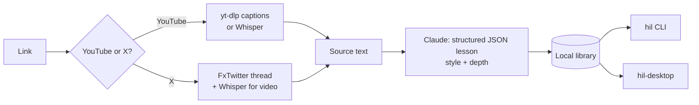

# 🍯 Honey Interactive Learn

**Paste a YouTube or X link. Get a lesson you'll remember.**

`hil` (CLI) and `hil-desktop` (GPUI app) turn a video or a post into a compact lesson. Each lesson has a TL;DR, key points, a diagram, code snippets, real-world examples, flashcards, a multiple-choice quiz and open questions. Pick the voice that fits how you learn: **plain**, **dev**, **visual** or **deep**. Pick the size: **brief**, **compact** or **comprehensive**.

[](https://github.com/umararshad4/honey-interactive-learn/actions/workflows/ci.yml)
[](https://github.com/umararshad4/honey-interactive-learn/releases)
[](LICENSE)

```text
$ hil learn https://www.youtube.com/watch?v=5C_HPTJg5ek --style dev --depth brief
✓ Rust in 100 Seconds · Fireship · 3788 chars of auto-captions

Rust Essentials: Memory Safety Through Ownership and Borrowing
YouTube · Fireship · 02:29 · dev / brief

TL;DR
Rust is a compiled systems language that is memory safe without a garbage collector…

Diagram: Ownership, move, borrow, drop
    let s = String::from("hi");      let t = s;  (move)
    +-------+      +---------+      +-------+
    | s     |----->| heap:hi |  ==> | t     |---> heap:hi
    +-------+      +---------+      +-------+
…
Take the quiz now? [Y/n]
```

## Features

- **YouTube.** Uses captions (manual first, then auto captions), plus the video description and chapters. Videos without captions fall back to local [Whisper](https://github.com/openai/whisper) transcription.
- **X / Twitter.** Reads posts, the author's whole thread, quoted posts and long-form articles, with no login needed (via the [FxTwitter](https://github.com/FixTweet/FxTwitter) API). Video posts are transcribed with Whisper.
- **Four learning styles:**

  | Style | What you get |
  |---|---|
  | `plain` | Everyday language, analogies, jargon defined on first use |
  | `dev` | Precise terms, runnable code snippets, commands, trade-offs and pitfalls |
  | `visual` | A detailed diagram as the centrepiece, tables, flows and hierarchies |
  | `deep` | First principles, edge cases, misconceptions and limits of the claims |

- **Three depths:** `brief` (about 3 quiz questions), `compact` (5) and `comprehensive` (10, with more sections and cards).
- **Practice built in.** An interactive MCQ quiz with explanations, score history and a "review these" list. Flip-style flashcards. Open questions with model answers.
- **Diagrams everywhere.** An ASCII diagram for the terminal and the app, and a Mermaid diagram in Markdown exports, which renders on GitHub, Obsidian and VS Code.
- **One library.** The CLI and the desktop app share the same saved lessons. `restyle` rewrites a saved lesson in another style without re-downloading the source.
- **Your model, your account.** Uses your existing **Claude Code** login through the `claude` CLI, or the **Anthropic API** when `ANTHROPIC_API_KEY` is set.

## Install

### Requirements

| Tool | Why | Install |
|---|---|---|
| `yt-dlp` | YouTube captions and video audio | `brew install yt-dlp` |
| `ffmpeg` | Audio decoding for Whisper | `brew install ffmpeg` |
| `whisper` *(optional)* | Videos without captions, X videos | `pipx install openai-whisper` |
| `claude` **or** `ANTHROPIC_API_KEY` | Writing the lesson | [Claude Code](https://claude.com/claude-code), or an [API key](https://console.anthropic.com/) |

Run `hil doctor` to check them all.

### Prebuilt binaries

Download from [Releases](https://github.com/umararshad4/honey-interactive-learn/releases):

- `hil`: macOS (Apple Silicon, Intel) and Linux x86_64
- `hil-desktop`: macOS (Apple Silicon)

```sh
tar xzf hil-v0.1.0-aarch64-apple-darwin.tar.gz
mv hil-v0.1.0-aarch64-apple-darwin/hil /usr/local/bin/
```

The binaries are not code-signed. On macOS, run `xattr -d com.apple.quarantine ./hil` if Gatekeeper blocks them.

### From source

Requires Rust 1.88+ for the CLI, and a recent stable Rust for the desktop app.

```sh
# CLI
cargo install --git https://github.com/umararshad4/honey-interactive-learn hil-cli

# Desktop app (macOS; Linux needs GPUI's system libraries)
git clone https://github.com/umararshad4/honey-interactive-learn
cd honey-interactive-learn
cargo run --release -p hil-desktop
```

## CLI usage

```sh
hil learn <url>                       # plain + compact by default
hil learn <url> -s dev -d comprehensive
hil learn <url> -s visual --quiz      # go straight into the quiz
hil list                              # your library, newest first
hil show 1                            # whole lesson (1 = newest, or an id prefix)
hil show 1 --only diagram --only code
hil show 1 --only quiz --answers
hil quiz 1                            # interactive MCQ quiz, saves your score
hil cards 1                           # flashcards
hil restyle 1 -s deep                 # same source, new style
hil export 1 -o lesson.md             # Markdown with Mermaid diagram
hil export 1 --json                   # raw lesson JSON
hil transcript <url>                  # just the extracted text
hil rm 1
hil doctor
```

Supported links: `youtube.com/watch?v=…`, `youtu.be/…`, `/shorts/…`, `/live/…`, `x.com/<user>/status/<id>`, `twitter.com/…`, `fxtwitter.com/…`.

## Desktop app

`hil-desktop` is a native GPU-rendered app built with [GPUI](https://gpui.rs) (the framework behind the Zed editor) and [gpui-component](https://github.com/longbridge/gpui-kit).

- **Sidebar:** a link box, style and depth pickers, and your library with best quiz scores.
- **Lesson tabs:** Overview, Diagram, Code, Examples, Flashcards (click to flip), Quiz (click an answer to see green/red feedback and the explanation), Q&A and Glossary.
- **Restyle** a lesson in place, and **export Markdown**.

| Overview | Diagram | Quiz |
|---|---|---|
|  |  |  |

Launch options: `hil-desktop --select <id-prefix> --tab quiz` opens a lesson straight to a tab.

## Configuration

| Variable | Default | Meaning |
|---|---|---|
| `HIL_BACKEND` | `auto` | `auto` (API if `ANTHROPIC_API_KEY` is set, otherwise `claude`), `claude-cli` or `api` |
| `HIL_MODEL` | API: `claude-opus-5-5`; CLI: your Claude Code default | Model override |
| `HIL_EFFORT` | `high` | API effort: `low`, `medium`, `high`, `xhigh` or `max` |
| `HIL_STYLE` / `HIL_DEPTH` | `plain` / `compact` | CLI defaults |
| `HIL_WHISPER_MODEL` | `base` | Whisper model (`tiny`, `small`, `medium`, `large`…) |
| `HIL_HOME` | platform data dir | Library location (`~/Library/Application Support/honey-interactive-learn` on macOS, `~/.local/share/honey-interactive-learn` on Linux) |
| `ANTHROPIC_API_KEY` / `ANTHROPIC_BASE_URL` | none | Anthropic API credentials and endpoint |

## How it works



See [docs/ARCHITECTURE.md](docs/ARCHITECTURE.md) for the crate layout and design decisions.

## Privacy

Extraction runs on your machine. The extracted text is sent to Anthropic, through your Claude Code session or your API key, to write the lesson. Lessons are stored locally as JSON. Nothing else leaves your machine.

## Development

```sh
cargo test -p hil-core -p hil-cli          # unit tests (no network)
cargo clippy --workspace --all-targets -- -D warnings
cargo run -p hil-cli -- learn <url>
cargo run -p hil-desktop
```

### Releasing

1. Move the `Unreleased` notes in [CHANGELOG.md](CHANGELOG.md) under a new version heading.
2. Bump `version` in the root `Cargo.toml` (`[workspace.package]`).
3. `git commit -am "release: vX.Y.Z" && git tag vX.Y.Z && git push --follow-tags`.

The [release workflow](.github/workflows/release.yml) builds the binaries and publishes a GitHub release with the changelog notes.

## Roadmap

- More sources: articles and blogs, podcasts, PDFs
- Spaced repetition for flashcards
- More model providers (OpenAI-compatible, Ollama)
- Signed macOS app bundle

## License

[MIT](LICENSE) © Umar Arshad
