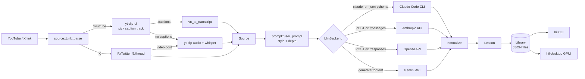

# Architecture

## Crates

| Crate | Role |
|---|---|
| `hil-core` | Link parsing, extraction, prompts, LLM backends, lesson model, library, quiz state, Markdown export. No UI code. |
| `hil-cli` | The `hil` binary: clap commands, terminal rendering, interactive quiz and flashcards (dialoguer). |
| `hil-desktop` | The `hil-desktop` binary built on GPUI (via `gpui-kit`). Blocking work runs on background threads. Packaged as a macOS `.app` by `packaging/macos/bundle.sh`. |

## Key decisions

- **External tools over reimplementation.** `yt-dlp` tracks YouTube changes daily and `whisper` runs locally, so the core shells out to both instead of scraping.
- **X without login.** FxTwitter's public API returns posts, threads, quotes and articles as JSON, so no X developer account is needed.
- **Pluggable providers.** `LlmBackend` has four implementations: the `claude` CLI, Anthropic, OpenAI and Gemini. None of them has an official Rust SDK, so each speaks raw HTTP. `BackendConfig` merges `settings.json` with environment variables, and `auto` picks the first provider that has a key.
- **Structured output.** All backends ask for JSON that matches `prompt::lesson_schema()`. `llm::normalize` then drops anything the UIs can't trust, such as an MCQ whose answer index is out of range.
- **One lesson file per lesson.** `~/Library/Application Support/honey-interactive-learn/lessons/<id>.json` on macOS, or `$HIL_HOME/lessons`. The CLI and the desktop app share it. The source text is stored inside the lesson, so `restyle` never re-downloads.
- **Generate once, view many ways.** The style changes what the model writes, so switching styles regenerates the lesson. Every lesson carries all parts (diagram, code, quiz…), and the UIs choose what to show.

## Known limits

- Very long sources are cut at 600k characters (about 150k tokens). The lesson notes this.
- X media other than video, such as images, is not described.
- Windows is untested. The `claude` npm shim may need a `.cmd` wrapper.
